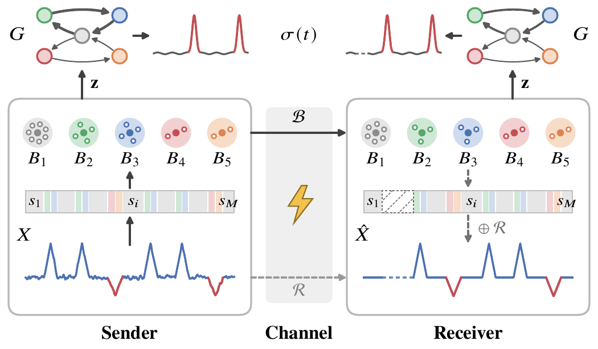

<h1 align="center">CoGa: Fast, Accurate, and Communication-Efficient Anomaly Detection with Time Series Compression</h1>

This repository is the official implementation of "CoGa: Fast, Accurate, and
Communication-Efficient Anomaly Detection with Time Series Compression", a novel
detection method over compressed time series.

## Introduction

The exponential growth of data generated by the Internet of Things (IoT) often
necessitates compression before transmitting to the network edge for analytics
such as anomaly detection. Existing recurrent-anomaly detectors require
reconstruction and rely on intensive subsequence modeling, incurring substantial
computational and memory costs. To address these limitations, we propose
**CoGa**, which enables recurrent subsequence anomaly detection directly on
compressed time series. Experiments on diverse public datasets show that CoGa
achieves the highest average AUC-ROC and AUC-PR with a 6.5× smaller
representation size than reconstruction-oriented baselines, runs up to 99× faster
and uses up to 50× less peak memory than the second-best method, and is more
robust to channel noise.

<p align="center">
  
</p>

## Installation

Clone the repository:

```bash
git clone https://github.com/GuoysAU/CoGaAD.git
cd CoGaAD
```

Then, inside `CoGaAD/`, create the environment and install the dependencies:

```bash
conda create -yn coga python=3.9
conda activate coga
pip install -r requirements.txt
```

## How to run

Download the five series used in the paper from the public TSB-UAD archive:

```bash
python data/fetch.py
```

To detect anomalies with CoGa, run the command:

```bash
python experiment.py
```

For each series, it prints the target SNR, the number of segments, ROC, PR, the
size of the compressed representation, and the runtime. The size is that of the
serialized Base after gzip compression; the raw size is that of the series as
32-bit floats after gzip compression.

To run a subset of the series, or a variant from the paper:

```bash
python experiment.py --datasets MBA805 IOPS                     # a subset of the series
python experiment.py --gamma-min 25 --gamma-max 25 --no-split   # fixed 25 dB target without the residual split
python experiment.py --terms node                               # node term of the path score only (or: edge)
python experiment.py --sweep --datasets MBA805                  # target-SNR range and alpha sweeps
```

To apply CoGa to your own series:

```python
from src import detect

result = detect(values)   # values: one-dimensional array
result.scores             # anomaly score per time point, in [0, 1]
```

## Contact

Feel free to contact the authors or open an issue if you run into a problem with
this implementation.
